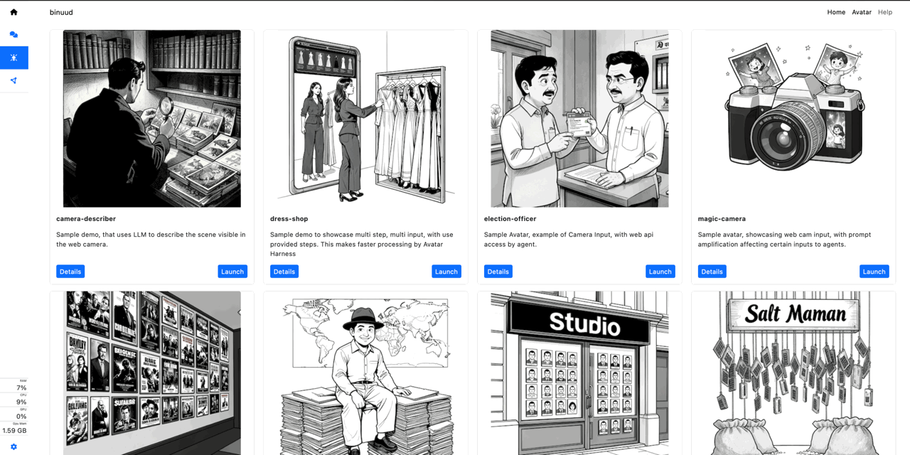

# avatar

[Detailed Documentation](https://binuud.com/docs/avatar)



Please refer to above link for the latest documentation.

Real World facing AI Agents, with memory, MCP Server Management, tool management. Tool whitelisting at agent level.

* Build your own customer facing agents
* Agents for Home Automation
* Harness for Agents
* MCP Server Manager
* White list MCP Server Access at agent level

This is a multi repo project, Avatar is the packager for all the Avatar Sub Projects. See at the end of this file, for 
all the sub project details.

Project status - open for alpha users

Remember to link local llm or external ai provider on the settings page.

## Install

* Using go install
```
go install github.com/binuud/avatar/cmd/avatar@latest
```

* Download the avatar binary from the release folder (https://github.com/binuud/avatar/releases)

* Access UI, after running the binary, using address
```
http://localhost:9080
```

## Metrics

The ui displays system metrics for CPU, RAM and GPU usage. The GPU memory, is the memory block allocated to GPU.

### Docker Image

Pull the docker image and start the container. The docker image has a very small footprint.

```bash
docker pull binuud/avatar:latest
```

```bash
mkdir dataVolume
docker run --rm  -v ./dataVolume:/dataVolume \
  -e FILE_STORE_PATH=/dataVolume \
  -p 9090:9090 -p 9080:9080 binuud/avatar:latest
```
(Tested and working on version 0.1.0)

Access from UI
```bash
http://localhost:9080
```

##### Prebuilt Binaries

[Prebuilt binaries are available here](https://github.com/binuud/avatar/releases)

##### Using Go Install

```bash
go install github.com/binuud/avatar/cmd/avatar@latest
```

```bash
mkdir dataVolume
export FILE_STORE_PATH=`pwd`/dataVolume
export SERVABLE_DIRECTORY=`pwd`/dataVolume/static
avatar
```
(Tested and working on version 0.1.1)


## Local Models

For local models

* llama.cpp
* ollama
* mlx serve (only on macos)

##### Build from source

```bash
git clone https://github.com/binuud/avatar.git
cd avatar
make vendor
make build
make run
```
(Tested and working on version 0.1.0)


[Environment settings for various LLM vendors](./documentation/env-examples.md)


## Avatar Project Collection

Avatar is a collection of the below projects

| For             | License     | Repo                                                      | 
| :---            | :----       | :---                                                      |
| Avatar          | MIT         | https://github.com/binuud/avatar                          |
| Conscious       | MIT         | https://github.com/binuud/avatar-conscious                |
| Development UI  | MIT         | https://github.com/binuud/avatar-dev-ui                   |
| Communication   | MIT         | https://github.com/binuud/avatar-communication-plane      |
| Physical Plane  | MIT         | https://github.com/binuud/avatar-physical-plane           |


## Further Documentation

* [Environment settings and examples for various LLM vendors](./documentation/env-examples.md)

